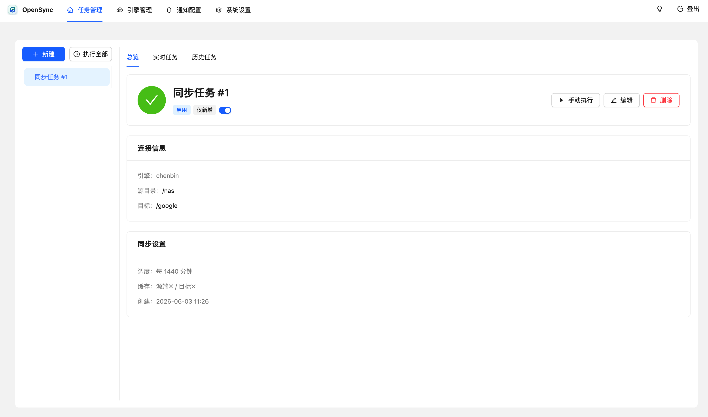
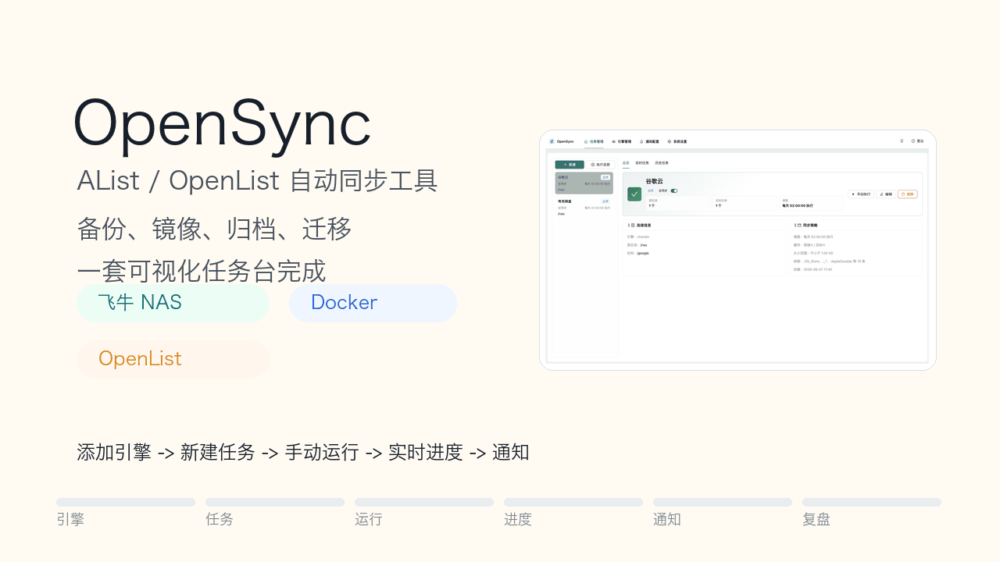
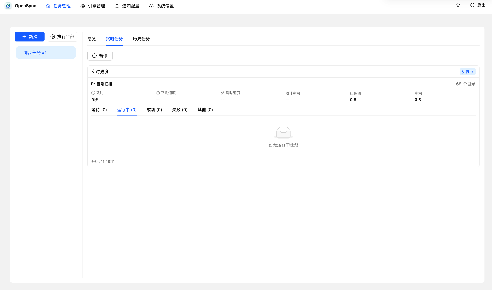
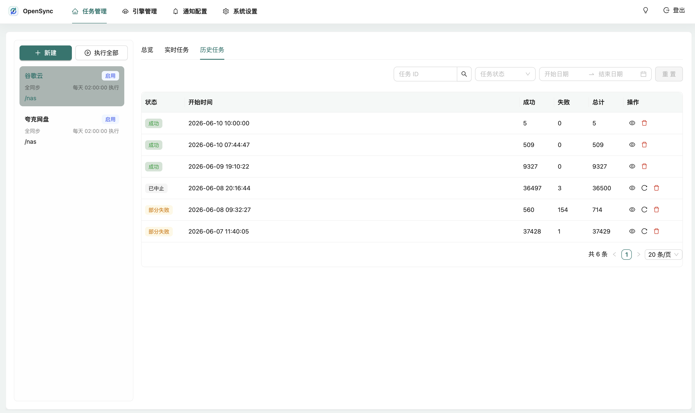
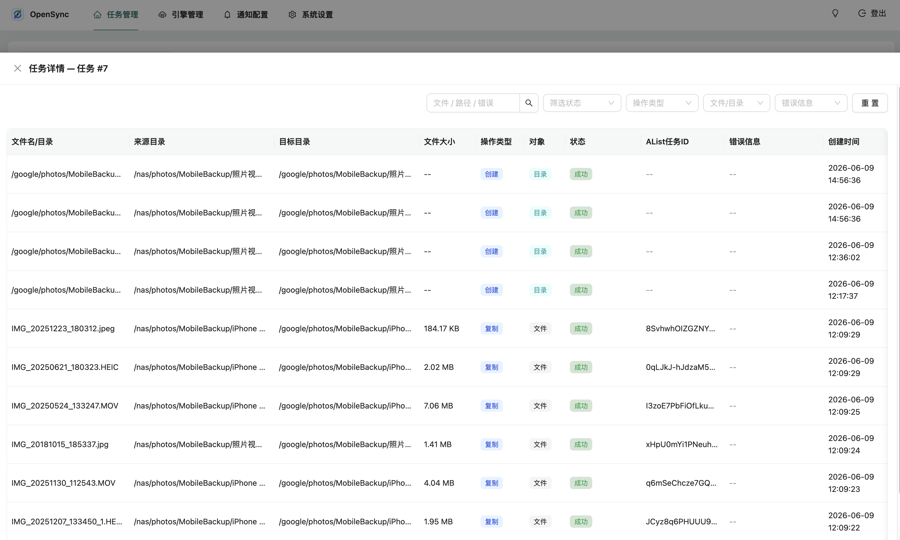
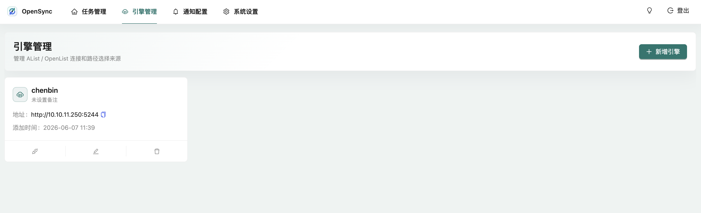
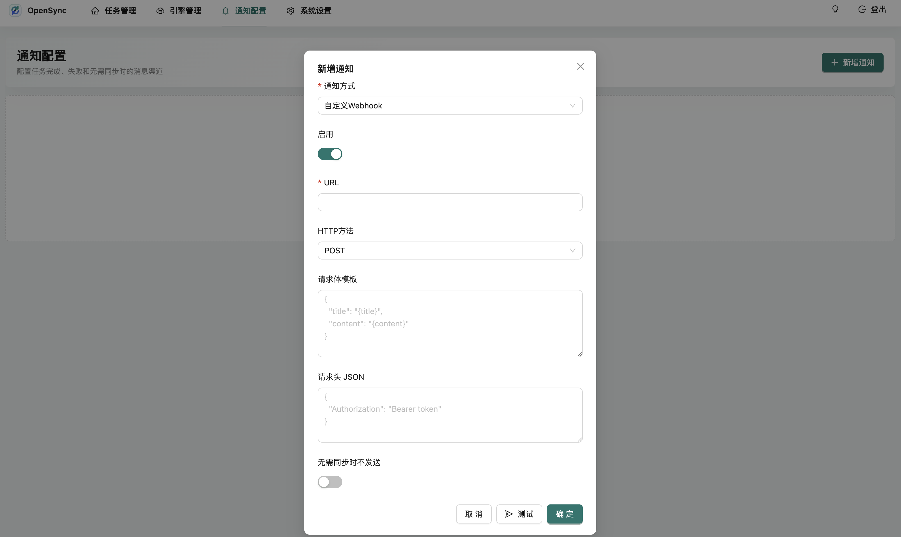
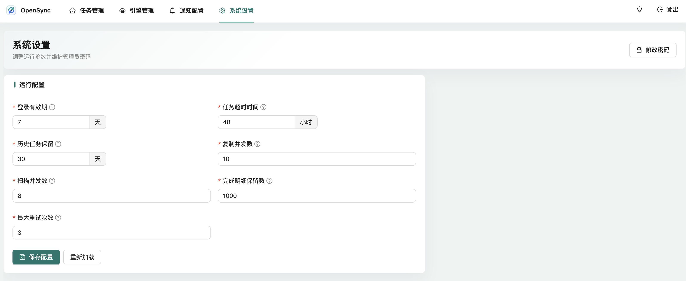

# OpenSync

> **飞牛 fnOS 用户看这里**：请安装 [OpenSync-fnOS 原生 fpk 版](https://github.com/chenbin3625/OpenSync-fnOS)，在飞牛 NAS 应用管理界面安装后即可使用，不需要 Docker。
>
> 在 [OpenSync-fnOS Releases](https://github.com/chenbin3625/OpenSync-fnOS/releases) 下载 `opensync-amd64.fpk`（x86 / amd64）或 `opensync-arm64.fpk`（ARM / arm64）。

[](https://github.com/chenbin3625/OpenSync/releases) [](https://hub.docker.com/r/chenbin3625/opensync) [](LICENSE)

[官网](https://opensync.u1n1.com/) | [30 秒演示](#30-秒演示) | [下载](https://github.com/chenbin3625/OpenSync/releases) | [Docker Hub](https://hub.docker.com/r/chenbin3625/opensync) | [讨论区](https://github.com/chenbin3625/OpenSync/discussions)

OpenSync 是一个给 **AList / OpenList** 加上「自动同步」的可视化小工具。

你已经在 AList / OpenList 里接好了网盘、NAS、WebDAV 或对象存储，但还想让文件按时自动备份、归档或迁移——OpenSync 就是做这件事的。打开网页，点几下就能建好任务，不用写脚本，也不用记命令行参数。

- 可以**定时自动执行**，也可以随时手动跑一次。
- 能看到**每个文件的实时进度**、速度和剩余时间。
- 失败的文件可以**只重试没完成的部分**。
- 任务完成或失败时，可以推送到**钉钉、企业微信、飞书、Server 酱或自定义 Webhook**。



## 目录

- [30 秒演示](#30-秒演示)
- [开始之前](#开始之前)
- [安装 OpenSync](#安装-opensync)
- [5 分钟完成第一个同步任务](#5-分钟完成第一个同步任务)
- [三种同步方式怎么选](#三种同步方式怎么选)
- [自动执行怎么设置](#自动执行怎么设置)
- [常见使用场景](#常见使用场景)
- [界面预览](#界面预览)
- [常见问题](#常见问题)
- [升级、备份与数据安全](#升级备份与数据安全)
- [高级配置](#高级配置)
- [反馈与社区](#反馈与社区)

## 30 秒演示



演示内容：添加 AList / OpenList 引擎、新建同步任务、手动运行、查看实时进度和接收通知。

## 开始之前

使用 OpenSync 只需要准备两样东西：

1. **一台能装 Docker 的设备**，例如飞牛 NAS、群晖、威联通、绿联、极空间、软路由或一台常开的 Linux 电脑；飞牛用户也可以直接安装原生 fpk。
2. **一个已经能正常使用的 AList / OpenList**。OpenSync 不直接连接各家网盘，而是通过 AList / OpenList 读写文件，所以请先在 AList / OpenList 里添加好你要同步的存储端。

### 准备 AList / OpenList 的地址和令牌

在 OpenSync 里添加引擎时，需要填写 AList / OpenList 的**服务地址**和**访问令牌（Token）**：

- 服务地址形如 `http://192.168.1.100:5244`，就是平时打开 AList / OpenList 网页的地址。
- 访问令牌可以在 AList / OpenList 管理后台的「设置 → 其他」中找到并复制；不同版本的菜单名称可能略有差异。

> 令牌相当于账号密码，请不要发到群里、截图里或公开的 Issue 中。

同一个同步任务里的源目录和目标目录，需要位于**同一个 AList / OpenList 实例**中。如果源和目标在不同的网盘，请先在 AList / OpenList 里把它们都添加为存储，再在 OpenSync 里选择对应目录。

## 安装 OpenSync

### 方式一：飞牛 fnOS 安装原生 fpk（推荐）

1. 打开 [OpenSync-fnOS Releases](https://github.com/chenbin3625/OpenSync-fnOS/releases)，下载与设备架构匹配的安装包：
   - x86 / amd64：`opensync-amd64.fpk`
   - ARM / arm64：`opensync-arm64.fpk`
2. 在飞牛 NAS 的「应用管理」中安装下载好的 fpk 包。
3. 安装完成后，在应用列表中打开 OpenSync。

发布页同时提供 `SHA256SUMS`，需要校验安装包时可以使用：

```bash
shasum -a 256 -c SHA256SUMS
```

### 方式二：Docker Compose（群晖 / 威联通 / Linux / 其它 NAS）

在设备的终端里执行：

```bash
mkdir -p opensync && cd opensync
curl -fsSLO https://raw.githubusercontent.com/chenbin3625/OpenSync/main/docker-compose.yml
docker compose up -d
```

如果你更喜欢图形界面，也可以在 NAS 的 Docker 管理界面中新建项目，把上面的 `docker-compose.yml` 内容粘贴进去再启动。

启动完成后，在浏览器打开：

```text
http://你的设备IP:8023/
```

例如设备 IP 是 `192.168.1.100`，就访问 `http://192.168.1.100:8023/`。

> 打不开页面时，先确认容器正在运行、设备防火墙放行了 `8023` 端口，并且手机 / 电脑和 NAS 在同一个局域网内。

### 首次打开：创建管理员账号

第一次访问时，页面会让你创建管理员用户名和密码。创建完成后，页面会**一次性显示一个 24 位恢复密钥**，请立刻保存到密码管理器或其它安全的地方。

- 这个恢复密钥只显示这一次。
- 忘记密码时，可以用「用户名 + 恢复密钥」在登录页重置密码。
- 重置成功后，旧的恢复密钥会失效，并生成一份新的恢复密钥。

如果恢复密钥也找不到了，可以在服务器上执行 CLI 兜底重置：

```bash
./opensync reset-password --user admin
```

Docker Compose 部署可以执行：

```bash
[ -f .env ] && . ./.env
docker compose exec --user "${PUID:-1000}:${PGID:-1000}" opensync ./opensync reset-password --user admin
```

运行后会输出新的密码和新的恢复密钥，请一并保存。

## 5 分钟完成第一个同步任务

下面以「把 NAS 上的照片目录每天自动备份到网盘」为例。第一次使用建议**先只选一个源目录和一个目标目录**，确认流程跑通后再增加。

### 第 1 步：添加存储引擎

1. 打开左侧菜单的「引擎管理」，点击「添加引擎」。
2. 填写 AList / OpenList 的服务地址和访问令牌，备注名称可以写成「家庭 NAS」「阿里云盘」等方便识别的名字。
3. 保存。OpenSync 会先验证地址和令牌是否可用，验证通过后才会保存。

可以添加多个引擎，但每个任务只能选择一个引擎。

### 第 2 步：新建同步任务

打开「任务管理」，点击「新建任务」，按顺序填写：

| 项目 | 怎么填 |
| --- | --- |
| 存储引擎 | 选择刚才添加的 AList / OpenList。 |
| 任务备注 | 给自己看的名字，例如「相册每日备份」。 |
| 源目录 | 要备份的目录，可以从目录树中选择，支持多选。 |
| 目标目录 | 备份放到哪里，同样支持多选。 |
| 同步方式 | 第一次备份建议选「仅新增」。 |
| 调度方式 | 想每天自动跑就选「Cron」，不想自动跑就选「仅手动」。 |
| 任务启用状态 | 保持开启，否则到点不会执行。 |

下面的「高级选项」可以按需设置：

- **最小 / 最大文件大小**：不限制时保持 `0`。
- **排除规则**：使用 .gitignore 格式，每行一条。默认已经排除了 `.DS_Store`、`Thumbs.db`、`@eaDir`、临时下载文件等常见垃圾文件。
- **源端 / 目标端缓存、扫描间隔**：不确定时保持默认即可。

填好后保存。任务会出现在任务列表中。

### 第 3 步：先手动跑一次

在任务卡片上点击「手动执行」，确认整条链路是通的。

运行期间点开「实时任务」，可以看到：

- 已扫描和已完成的文件数量；
- 当前传输速度与预计剩余时间；
- 已完成、失败、等待和正在传输的文件明细；
- 运行中的任务可以随时点击「停止」。

第一次备份文件较多时耗时会比较长，可以先去忙别的，任务会在后台继续。

### 第 4 步：查看结果并设置自动执行

手动跑完后，打开「历史任务」查看本次结果：

- **成功**：所有文件都已同步。
- **部分失败**：有文件没同步成功，点开详情可以看到具体文件和错误原因。
- **无需同步**：目标端已经是最新的，没有需要复制的文件。

确认手动执行没有问题后，再回到任务编辑页，把「调度方式」改成你需要的自动计划（下一节有详细说明），并保持任务启用。

### 第 5 步：配置通知（可选）

打开「通知配置」，点击「添加通知」，可以选择：

- 自定义 Webhook
- Server 酱
- 钉钉机器人
- 企业微信应用
- 飞书 / Lark 机器人

保存前可以点击「测试」发送一条测试消息。打开「无需同步时静默」后，没有文件需要同步时就不会打扰你。

### 第 6 步：失败后怎么处理

如果任务失败或部分失败：

1. 打开「历史任务」，点进对应的记录。
2. 查看失败文件的错误信息，常见原因是目标端空间不足、目录没有写入权限、Token 失效或网络不稳定。
3. 修复问题后，点击「重试未完成项」，OpenSync 只会重试失败和未完成的文件，不会从头再来。

## 三种同步方式怎么选

| 同步方式 | 会做什么 | 适合场景 | 要注意 |
| --- | --- | --- | --- |
| **仅新增** | 复制源端有、目标端没有或内容变化的文件；不会删除目标端多余的文件。 | 相册备份、文档备份、日常增量备份。 | 源端删除了文件，目标端仍会保留。 |
| **全同步** | 让目标目录和源目录保持一致，会删除目标端多出来的文件。 | 影音库镜像、需要严格一致的副本。 | 删除操作不可撤销，第一次使用前请先确认目标目录选对了。 |
| **移动模式** | 文件成功传到目标后，从源端删除，相当于「归档 + 腾空间」。 | 下载目录归档、把旧文件迁到冷存储。 | 会删除源文件，第一次请只选一个小目录试跑。 |

> **移动模式特别提醒**：不要把同一个目录同时设为源和目标，也不要把同一份数据的重复挂载、别名或符号链接当作不同的源和目标。

## 自动执行怎么设置

新建或编辑任务时，「调度方式」有三种选择：

| 调度方式 | 说明 | 例子 |
| --- | --- | --- |
| **间隔(分钟)** | 每隔 N 分钟执行一次，从任务保存或启用后开始计算。 | 填 `60` 表示每小时跑一次。 |
| **Cron** | 按指定时间执行，适合固定时间备份。 | 每天凌晨 2 点跑一次。 |
| **仅手动** | 不自动执行，只在你点「手动执行」时运行。 | 临时迁移、偶尔整理。 |

Cron 使用 6 个字段，依次是「秒 分 时 日 月 周」：

| 需求 | Cron 表达式 |
| --- | --- |
| 每天凌晨 2:00 | `0 0 2 * * *` |
| 每小时整点 | `0 0 * * * *` |
| 每周日凌晨 3:00 | `0 0 3 * * 0` |
| 每 30 分钟 | `0 */30 * * * *` |

任务使用容器或系统设置的 `TZ` 时区（默认 `Asia/Shanghai`）。如果发现执行时间和预期差了几个小时，先检查时区配置。

## 常见使用场景

| 我想做什么 | 怎么做 |
| --- | --- |
| 手机照片自动备份到网盘或对象存储 | 源目录选照片文件夹，目标目录选网盘备份目录，用「仅新增」，每天执行。 |
| 下载完成的文件自动搬到另一台 NAS | 先用「仅新增」验证路径和权限，再改成「移动模式」定时执行。 |
| 把一个影音库完整镜像到另一个存储 | 使用「全同步」，让目标端与源端保持一致。 |
| 在不同网盘之间迁移文件 | 在 AList / OpenList 中同时挂载两个存储，任务里选择对应的源目录和目标目录。 |
| 只备份某些类型的文件 | 用最小 / 最大文件大小筛选，或在排除规则中排除不需要的目录和扩展名。 |

更详细的分步教程：

- [飞牛相册自动备份到 WebDAV / S3](docs/guides/fnos-photo-backup.md)
- [下载目录自动归档到另一台 NAS](docs/guides/download-archive.md)
- [AList / OpenList 多存储之间的定时迁移](docs/guides/storage-migration.md)

## 界面预览

### 任务管理

任务卡片会显示源目录、目标目录、同步方式和调度计划，可以直接执行、停止、编辑或删除。


### 实时任务

运行过程中可以查看扫描数量、传输速度、剩余时间和每个文件的状态。



### 历史任务

每次执行都会留下记录，可以查看开始时间、耗时、结果，并重试未完成项。



### 任务详情

汇总扫描与传输统计，并逐条列出每个文件的同步状态和错误信息。



### 引擎管理

管理多个 AList / OpenList 实例，保存前自动验证地址和令牌，已保存的令牌不会回显。



### 通知配置

添加 Webhook、Server 酱、钉钉、企业微信或飞书通知，保存前可以发送测试消息。



### 系统设置

在这里调整登录有效期、任务超时、历史记录保留时间、并发和自动重试，也可以修改管理员密码。



## 常见问题

### 打开页面提示无法访问

1. 确认容器正在运行：Docker 中查看 `opensync` 容器的状态和日志。
2. 确认端口 `8023` 没有被其它程序占用。
3. 确认 NAS 防火墙或路由器没有拦截该端口。
4. 使用 `http://设备IP:8023/` 访问，注意是 `http` 而不是 `https`（除非你自行配置了反向代理）。

### 忘记管理员密码怎么办

在登录页点击「忘记密码？使用恢复密钥找回」，输入用户名、之前保存的 24 位恢复密钥和新密码。重置成功后请保存新生成的恢复密钥。

如果恢复密钥也丢了，使用上面的 `reset-password` 命令在服务器上重置。

### 任务为什么没有自动执行

- 检查任务是否处于「已启用」状态。
- 检查调度方式是不是「仅手动」。
- 检查 Cron 表达式是否正确，特别注意它是 6 位（包含秒）。
- 检查时区是否符合预期。
- 如果上一次任务还没结束，本次定时触发会被跳过，避免同一个任务并发运行。可以等它结束，或先停止正在运行的任务。

### 为什么一直显示「无需同步」

说明目标端已经和源端一致，没有需要复制的文件。这是正常状态。如果同时开启了「无需同步时静默」，这种情况下不会发送通知。

### 同步失败了，源文件会丢吗

「仅新增」和「全同步」不会删除源端文件。「移动模式」只有在文件成功传输后才会删除源端文件；未成功的文件不会被删除，可以先修复问题再重试。

### 目标端少了一些文件

按顺序检查：

1. 文件是否被排除规则过滤掉了（默认排除临时文件、系统缓存目录等）。
2. 是否设置了最小 / 最大文件大小限制。
3. 该文件是否在历史任务里显示失败，点开详情看具体错误。
4. 目标端是否空间不足或没有写入权限。

### 支持哪些网盘和存储

OpenSync 通过 AList / OpenList 访问存储，所以支持范围取决于你的 AList / OpenList 版本和已配置的存储端，包括本地磁盘、WebDAV、S3 兼容对象存储以及 AList / OpenList 支持的各类网盘。

### 可以多选源目录和目标目录吗

可以。任务会把每个源目录同步到每个目标目录；选择多个源目录时，目标端会自动保留各自的目录层级，避免不同来源的文件混在一起。第一次使用仍建议先单源单目标跑通。

### 任务运行很久会超时吗

默认单次任务超时为 48 小时，可以在「系统设置」中调整，单位为**小时**，填 `0` 表示不限制。超时后 OpenSync 会停止扫描和传输，并请求取消远端任务。修改后只对新启动的任务生效。

### 手机能使用吗

可以。OpenSync 的网页适配了手机浏览器，在同一局域网内用手机访问 `http://设备IP:8023/` 即可查看和操作任务。

### 想从公网访问怎么办

建议通过带 HTTPS 的反向代理（例如 Nginx Proxy Manager、Caddy）访问，并配置强密码。不要直接把 `8023` 端口暴露到公网，也不要公开 `data/` 目录。

## 升级、备份与数据安全

### 升级 OpenSync

1. 先备份挂载出来的 `data/` 目录。
2. 拉取最新镜像（或指定版本镜像）并重新启动容器。
3. 首次启动会自动完成数据库迁移。

飞牛 fpk 用户直接在应用管理界面安装新版本 fpk 即可。

### 数据保存在哪里

Docker 部署的所有数据都在 `data/` 目录中，包括账号、引擎配置、任务、历史记录、日志和密钥。

**请定期备份这个目录。** 丢失 `data/` 等于丢失所有任务和历史记录。

### 升级时不要删除 secret.key

`data/secret.key` 用于加密敏感信息和登录 Cookie。升级时保留它，否则旧登录状态和已保存的敏感信息可能失效。

### 安全提醒

- 不要公开 `data/` 目录，也不要把包含 AList / OpenList Token 的文件、日志或截图发到网上。
- 如果误分享了运行数据目录，请立即更换相关 Token。
- 漏洞反馈和加固建议见 [SECURITY.md](SECURITY.md)。

## 高级配置

大多数用户不需要修改下面的内容。Docker 部署时，可以在 `docker-compose.yml` 的 `environment` 中按需添加环境变量：

| 变量 | 默认值 | 说明 |
| --- | --- | --- |
| `TZ` | `Asia/Shanghai` | 容器和定时任务使用的时区 |
| `PUID` / `PGID` | `1000` / `1000` | 运行容器使用的宿主机用户和用户组，用于避免产生 root 权限文件 |
| `OPENSYNC_PORT` | `8023` | Web 服务端口 |
| `OPENSYNC_EXPIRES` | `7` | 登录有效期，单位天 |
| `OPENSYNC_TASK_SAVE` | `30` | 历史任务保留天数，`0` 表示永久保留 |
| `OPENSYNC_TASK_TIMEOUT` | `48` | 单次任务超时，单位小时，`0` 表示不限制 |
| `OPENSYNC_COPY_CONCURRENCY` | `5` | 单个任务的文件复制并发数，范围 1 到 100 |
| `OPENSYNC_SCAN_CONCURRENCY` | `8` | 单个任务的目录扫描并发数，范围 1 到 20 |
| `OPENSYNC_MAX_RETRIES` | `2` | 单个文件失败后的自动重试次数，`0` 表示不重试 |
| `OPENSYNC_TRUSTED_PROXIES` | 空 | 信任的反向代理 CIDR 列表，逗号分隔 |

历史任务保留时间、任务超时、并发和重试次数也可以直接登录网页，在「系统设置」中修改，不需要重启容器。

> `data/config.ini` 一旦存在，除 TLS 相关配置外的环境变量在重启后将不再生效，以配置文件为准。

### 自定义 Webhook

在「通知配置」中选择「自定义 Webhook」后：

- `URL` 必填，支持内网或本机地址。
- HTTP 方法支持 `GET`、`POST`、`PUT`，默认 `POST`。
- `GET` 会把标题和内容作为 `title`、`content` 查询参数发送。
- `POST` / `PUT` 默认以 `application/json` 发送。
- 请求体模板可选，必须是 JSON 对象，支持 `{title}` 和 `{content}` 占位符。
- 自定义请求头可选，适合填写 `Authorization`、`X-Token` 等鉴权头。

示例请求体：

```json
{
  "title": "{title}",
  "content": "{content}"
}
```

示例请求头：

```json
{
  "Authorization": "Bearer your-token"
}
```

### 使用 Docker 命令部署

不使用 Docker Compose 时，也可以直接运行容器：

```bash
docker run -d \
  --name opensync \
  --restart unless-stopped \
  -p 8023:8023 \
  -v opensync-data:/app/data \
  --tmpfs /tmp:mode=1777 \
  -e TZ=Asia/Shanghai \
  -e OPENSYNC_PORT=8023 \
  chenbin3625/opensync:latest
```

完整的 `docker-compose.yml`：

```yaml
services:
  opensync:
    image: chenbin3625/opensync:latest
    container_name: opensync
    restart: unless-stopped
    ports:
      - "8023:8023"
    volumes:
      - ./data:/app/data
    tmpfs:
      - /tmp:mode=1777
    environment:
      TZ: Asia/Shanghai
      PUID: ${PUID:-1000}
      PGID: ${PGID:-1000}
      SQLITE_TMPDIR: /tmp
      TMPDIR: /tmp
      OPENSYNC_BIND: 0.0.0.0
      OPENSYNC_PORT: 8023
      GIN_MODE: release
```

每次发布同时提供版本号标签和 `latest`，`latest` 始终指向最新稳定版。

## 反馈与社区

- 遇到可复现的问题：提交 [Issue](https://github.com/chenbin3625/OpenSync/issues)。
- 使用求助、部署经验、功能建议：发到 [Discussions](https://github.com/chenbin3625/OpenSync/discussions)。
- 提交代码前请阅读 [CONTRIBUTING.md](CONTRIBUTING.md)。

提交问题前请先搜索已有内容，并记得给 Token、私有路径、账号名和主机名打码。

## 许可证

本项目以 [MIT License](LICENSE) 授权。
