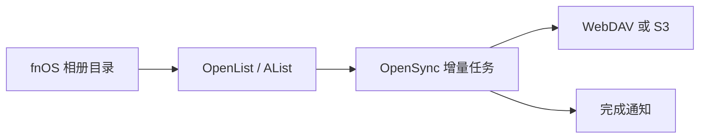

# 飞牛相册自动备份到 WebDAV / S3

这套配置适合把 fnOS 上的照片目录定时备份到 WebDAV 或 S3 兼容对象存储。源端保留原文件，目标端只新增或更新文件，适合长期保留照片。

## 30 秒安装

飞牛用户优先安装 [OpenSync-fnOS 原生 fpk](https://github.com/chenbin3625/OpenSync-fnOS/releases)。如果你使用 Docker，复制下面的命令：

```bash
mkdir -p opensync && cd opensync && curl -fsSLO https://raw.githubusercontent.com/chenbin3625/OpenSync/main/docker-compose.yml && docker compose up -d
```

打开 `http://你的设备IP:8023/`，首次启动时创建管理员账号并保存一次性显示的恢复密钥。

## 配置流程



1. 在 OpenList / AList 中准备一个本地照片目录和一个 WebDAV 或 S3 存储端。
2. 在 OpenSync 的「引擎管理」中分别添加源端和目标端，保存前先测试连接。
3. 新建任务，源目录选择照片目录，目标目录选择备份目录，同步模式选择「仅新增」。
4. 设置每天或每小时执行一次，先手动运行一遍，确认目标端能打开照片后再启用计划。
5. 在「通知配置」中添加 Webhook、Server 酱、钉钉、企业微信、飞书或 Bark，按需开启“无文件变化时不发送”。

## 失败恢复

在「历史任务」中打开失败记录，查看具体文件和错误信息，只重试未完成项。不要为了排障删除 `data/`，它包含任务历史和运行配置。先修复目标端权限、网络或空间问题，再重试任务。

## 发布入口

[OpenSync-fnOS Releases](https://github.com/chenbin3625/OpenSync-fnOS/releases) 提供对应架构的 `.fpk` 和 `SHA256SUMS`；Docker 用户使用 [OpenSync Releases](https://github.com/chenbin3625/OpenSync/releases)。

不要把 AList / OpenList Token 提交到仓库或截图中；分享日志前先脱敏。
