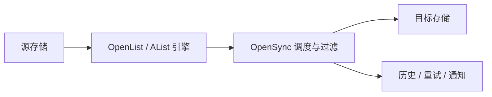

# AList / OpenList 多存储之间的定时迁移

这套配置适合在多个网盘、对象存储、WebDAV 和本地目录之间做可追踪的备份、镜像或迁移。它把一次性的复制命令变成有历史、有重试、有通知的任务。

## 30 秒安装

```bash
mkdir -p opensync && cd opensync && curl -fsSLO https://raw.githubusercontent.com/chenbin3625/OpenSync/main/docker-compose.yml && docker compose up -d
```

打开 `http://你的设备IP:8023/`，创建管理员账号并保存恢复密钥。飞牛用户可改用 [OpenSync-fnOS 原生 fpk](https://github.com/chenbin3625/OpenSync-fnOS/releases)。

## 配置流程



1. 在 OpenList / AList 中为每个源和目标准备独立的存储引擎，并确认账号至少具备列举、读取和写入权限。
2. 在 OpenSync 的「引擎管理」中逐个添加并测试连接，给引擎使用能看懂的名称，例如“旧网盘”和“对象存储”。
3. 新建任务：需要保留目标端多余文件时选「仅新增」，需要目标端跟随源端时选「全同步」，确认迁移完成后再考虑「移动」。
4. 配置文件名、后缀、目录和大小过滤，先手动运行一小批文件，确认路径和数量无误后再启用 Cron 或间隔计划。
5. 为长时间任务设置通知，并把任务历史保留时间调到足以覆盖一次迁移验收周期。

## 失败恢复

在「历史任务」中按状态或关键词筛选，打开详情确认是源端读取、目标端写入还是网络错误。修复问题后只重试未完成项；不要直接删除任务历史或运行数据。大规模迁移先拆成多个目录任务，方便定位和回滚。

## 发布入口

版本、二进制和校验文件见 [OpenSync Releases](https://github.com/chenbin3625/OpenSync/releases)。Docker 用户也可以先固定一个版本标签，再按 Release 说明升级。

存储端 Token 只放在本地配置中，提交 Issue 或分享配置时请先脱敏。
